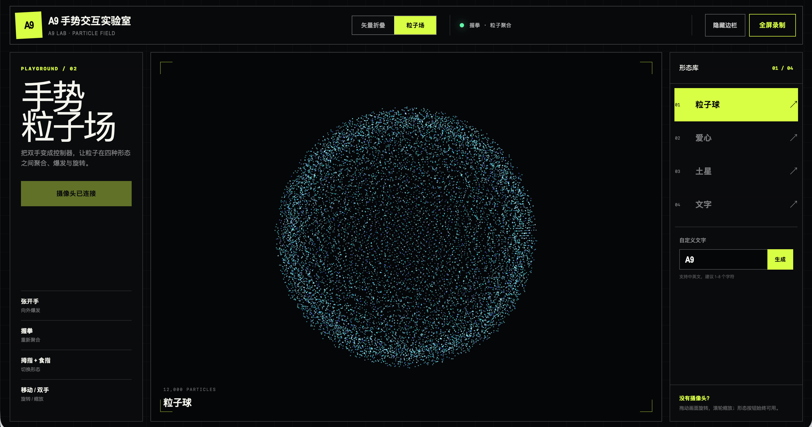
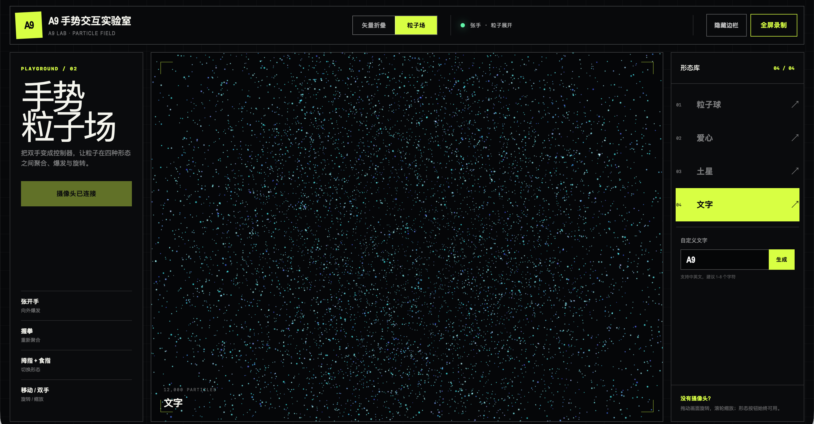
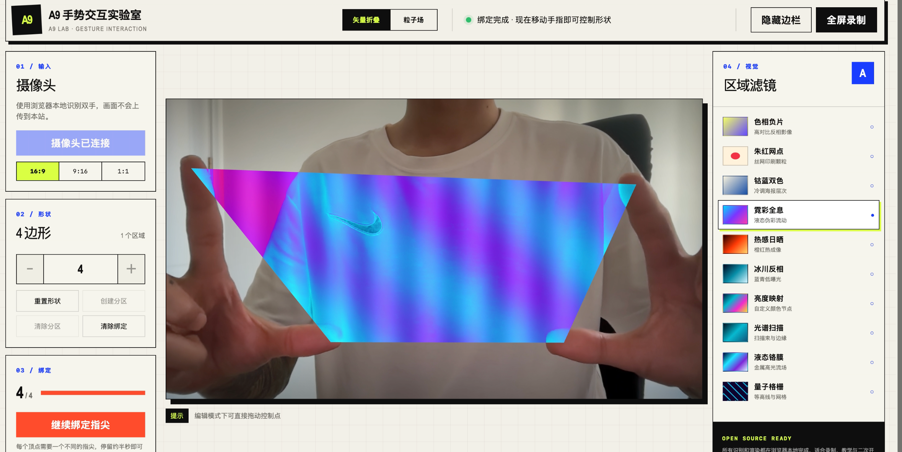

# 手势交互实验室

一个完全运行在浏览器中的手势互动视觉实验室。使用普通摄像头和 MediaPipe 识别双手，通过 Three.js 与 WebGL 控制矢量折叠和 3D 粒子效果。

## 在线体验

本仓库不附带线上演示站，请按下方步骤在自己的电脑上运行。


## 怎么玩

### 1. 下载并启动

环境要求：Node.js 20.9 或更高版本，推荐使用最新版 Chrome 或 Edge。

```bash
git clone https://github.com/lf1810/Alex.git
cd Alex/projects/gesture-lab
npm install
npm run dev
```

打开终端显示的本地地址（通常是 `http://localhost:3000`），点击“启用摄像头”，并在浏览器提示中选择“允许”。

不熟悉 Git 的用户也可以点击仓库右上方的 **Code → Download ZIP**，解压后在该文件夹中运行 `npm install` 和 `npm run dev`。

### 2. 选择互动模式

**矢量折叠**

1. 选择 3–8 边形和喜欢的视觉滤镜。
2. 按页面提示，依次把顶点绑定到不同指尖。
3. 移动双手，实时拉伸、翻转和折叠图形。
4. 点击“隐藏边栏”获得干净画面，使用“全屏录制”采集素材。

**3D 粒子场**

- 张开手掌：粒子向外展开。
- 握拳：粒子重新聚合。
- 拇指与食指捏合：切换球体、爱心、土星和文字。
- 移动手掌：旋转粒子。
- 改变双手距离：缩放整个粒子系统。

粒子页没有摄像头时仍可使用鼠标拖动旋转、滚轮缩放和右侧按钮切换形态。为了提高识别稳定性，请保持手部光线充足，并让双手完整出现在摄像头范围内。

## 效果展示

### 3D 粒子场

| 粒子球聚合 | 张手展开粒子 |
| --- | --- |
|  |  |

### 矢量折叠



## 主要功能

### 矢量折叠

- 双手五指实时追踪
- 3–8 边形编辑与控制点拖动
- 顶点绑定到不同指尖，丢失后自动恢复
- 区域分割和十种实时视觉滤镜
- 16:9、9:16、1:1 三种录制比例

### 3D 粒子场

- 12,000 个实时 WebGL 粒子
- 球体、爱心、土星和自定义文字
- 张开手掌：展开粒子
- 握拳：重新聚合
- 拇指与食指捏合：切换形态
- 移动手掌：旋转粒子
- 双手距离：缩放粒子系统
- 无摄像头时可使用鼠标拖动和滚轮

两个页面均支持隐藏边栏和全屏录制。粒子页只在后台读取摄像头进行识别，不显示用户摄像头画面。

## 隐私

- 摄像头画面只在当前浏览器中处理。
- 项目不会上传、保存或传输摄像头视频。
- 页面关闭后，浏览器会释放摄像头。
- 部署到线上时必须使用 HTTPS，`localhost` 本地开发不受此限制。

## 技术栈

- Next.js 16
- React 19
- TypeScript
- Three.js / WebGL
- MediaPipe Tasks Vision
- Tailwind CSS

## 检查与构建

```bash
npm test
npm run build
```

## 项目结构

```text
app/
├── GestureStage.tsx          # 矢量折叠与指尖绑定
├── particles/
│   └── ParticleLab.tsx       # 3D 粒子和手势识别
├── globals.css               # 全站视觉样式
└── layout.tsx
public/
tests/
```

## 浏览器建议

推荐使用最新版 Chrome 或 Edge，并确保手部光线充足。低性能设备可以关闭其他占用显卡的页面。

## 参与贡献

欢迎提交问题和改进建议，详见 [CONTRIBUTING.md](./CONTRIBUTING.md)。

## 开源协议

本项目使用 [MIT License](./LICENSE)。


---

## 署名与来源

本仓库是 [a9-gesture-lab](https://github.com/dangminhhuong71567-oss/a9-gesture-lab) 的派生版本（白标定制）。

- 原作者：A nine <dangminhhuong71567@gmail.com>（A9 LAB）
- 原许可证：MIT（原始版权声明与许可证全文保留于 `LICENSE`，未改动）
- 本派生版本修改部分版权：Copyright (c) 2026 Alex (lf1810)

修改范围：界面品牌标识（A9 LAB → Alex）、包元数据（name、author）及 README、测试中的品牌引用；核心实现来自原项目。
详见根目录 [`NOTICE`](./NOTICE)。

> 本仓库地址：https://github.com/lf1810/Alex/tree/main/projects/gesture-lab
